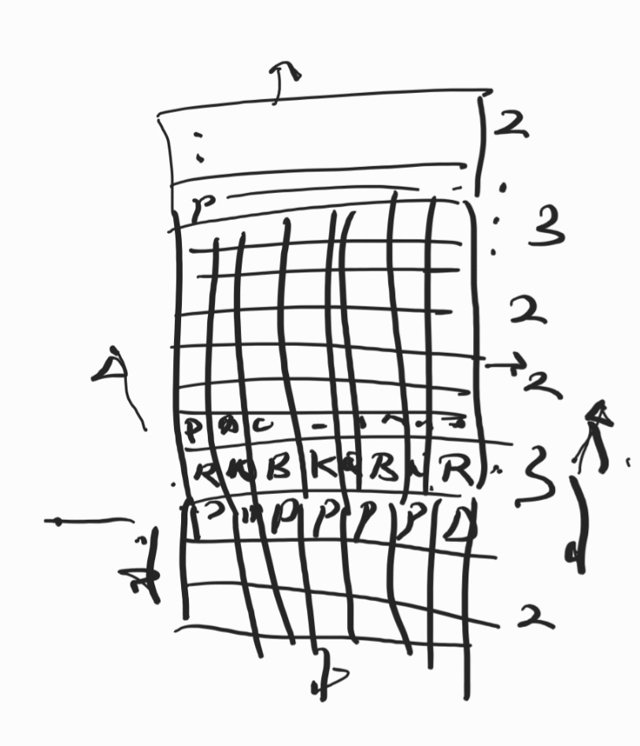

# torus-chess
A drunk idea of chess on a torus board.

Below is a basic sketch of my idea of a torus board:


## Rules

- The board is 14 rows × 8 columns and wraps in both directions (a torus).
- Each army takes three rows: pawns, back rank (R N B K Q B N R), pawns. The armies are separated by 4 empty rows on each side.
- Each pawn row moves away from its own back rank and promotes on reaching the enemy back rank. It can double-step on its first move, and en passant applies.
- Sliding pieces continue around the wrap until blocked.
- Castling: the king moves two squares toward the first unmoved rook in that direction (even across the wrap), and the rook jumps over it.
- Checkmate wins. Stalemate, the fifty-move rule, threefold repetition and insufficient material are draws.

## Running

```sh
cd frontend
npm install
npm run dev
```

Play against the computer (four difficulty levels) or with two players on one screen. Drag the board, scroll, or use the arrow keys to roll the torus.

